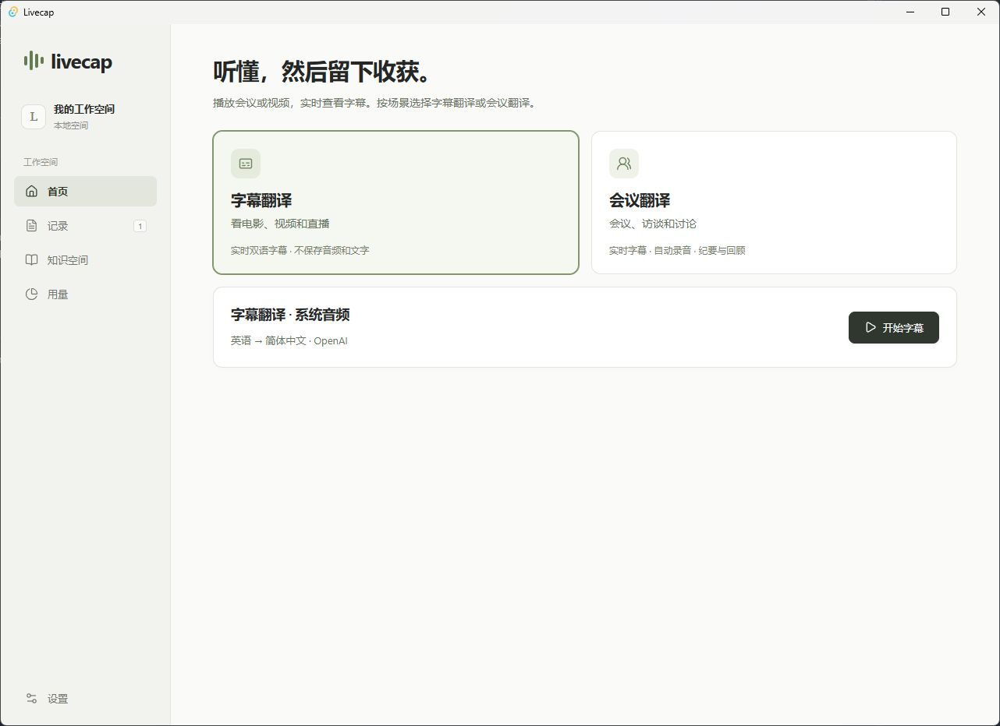

<h1 align="center">Livecap</h1>

<p align="center">
  <a href="https://github.com/MiaoForge/livecap/actions/workflows/ci.yml"></a>
  <a href="LICENSE"></a>
  <a href="docs/development.md"></a>
  <a href="https://github.com/MiaoForge/livecap/releases"></a>
</p>

<p align="center"><a href="README.md">English</a> · <a href="docs/README.md">文档（英文）</a></p>

适用于 Windows 和 macOS 的实时双语字幕和会议记录工具。

Livecap 翻译电脑正在播放的声音。看视频或参会时，可以在可移动的悬浮窗看字幕，也可以保存会议供事后回顾。



## 从实时字幕到会议回顾

- **字幕翻译**在独立浮窗显示原文和译文。会话结束后清空音频和文字，保留用量。
- **会议翻译**保存录音和转录，支持回听、校对，并可从纪要和时间线跳转到对应的录音位置。
- **知识空间**从公开资料整理领域术语，供后续会话复用。
- **用量**显示字幕、会议和知识准备的预计费用。

Livecap 使用你配置的 OpenAI 或 Soniox API Key，并把密钥保存在 Windows 凭据管理器或 macOS 钥匙串中。所选服务会收到当前播放设备的声音，包括其他应用和通知音。会议默认还会采集系统默认麦克风，可在开始前关闭“同时录制麦克风”。[使用指南](docs/getting-started.md)

## 获取 Livecap

发布流程构建 Windows x64 安装包和 macOS Apple Silicon 磁盘映像，通过 [GitHub Releases](https://github.com/MiaoForge/livecap/releases) 分发。发布版可在「设置 → 通用」检查更新。

### 从源码运行

在 Windows 安装 Node.js 24、Rust MSVC 工具链、Visual Studio C++ Build Tools 和 WebView2，然后在项目目录运行以下命令。

```powershell
npm ci
npm run tauri dev
```

在「设置 → 连接服务」选择 OpenAI 或 Soniox 并保存 API Key，然后开始字幕翻译或会议翻译。

## 开发

提交前运行 `npm run check`。具体命令和项目约定见[开发指南](docs/development.md)和[仓库说明](AGENTS.md)。

## 许可证

[GNU General Public License v3.0 only](LICENSE)（`GPL-3.0-only`）。

## macOS 支持

支持 macOS 13 及以上的 Apple Silicon Mac。安装 Node.js 24、稳定版 Rust 和 Xcode Command Line Tools（`xcode-select --install`），运行 `npm ci` 和 `npm run tauri dev`。首次采集需在系统设置的“隐私与安全性 → 屏幕与系统音频录制”中授权，按系统提示重新启动应用。API 密钥保存在 macOS 钥匙串中。构建和验证步骤见 [macOS guide](docs/macos.md)。
