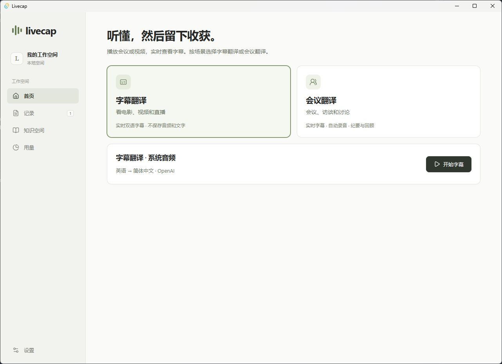

<h1 align="center">Livecap</h1>

<p align="center">
  <a href="https://github.com/MiaoForge/livecap/actions/workflows/ci.yml"></a>
  <a href="LICENSE"></a>
  <a href="docs/development.md"></a>
  <a href="https://github.com/MiaoForge/livecap/releases"></a>
</p>

<p align="center"><a href="README-zh.md">简体中文</a> · <a href="docs/README.md">Documentation</a></p>

Live bilingual captions and replayable meeting records for Windows.

Livecap translates the audio you hear on your PC. Keep captions in a movable overlay while watching a video or joining a call, or save a meeting for review afterward.



_The Livecap workspace in Simplified Chinese._

## From live captions to meeting review

- **Subtitle mode** shows original text and translations in a separate overlay. Audio and text are cleared after the session, and usage totals are retained.
- **Meeting mode** saves a recording and transcript. Replay the audio, correct text, and jump from notes or timeline entries to the relevant moment.
- **Knowledge Space** prepares terminology from public sources and reuses it in later sessions.
- **Usage** shows estimated provider costs for captions, meetings, and knowledge preparation.

Livecap uses your OpenAI or Soniox API key and stores it in Windows Credential Manager. The selected provider receives audio from the active playback device, including sounds from other apps and notifications. See [getting started](docs/getting-started.md) for setup and local data details.

## Get Livecap

Windows x64 installers are distributed through [GitHub Releases](https://github.com/MiaoForge/livecap/releases). Open **Settings → General** to check for updates in a release build.

### Quick start

On Windows, install Node.js 24, stable Rust with the MSVC toolchain, Visual Studio C++ Build Tools, and WebView2. From the project directory, run:

```powershell
npm ci
npm run tauri dev
```

Choose OpenAI or Soniox under **Settings → Connection**, save your API key, and start a subtitle or meeting session.

## Documentation

- [Getting started](docs/getting-started.md) covers provider setup, session modes, and data storage.
- [Development](docs/development.md) covers local builds, tests, and CI.
- [Architecture](docs/architecture.md) explains audio capture, translation, and persistence.
- [Releases](docs/releases.md) covers signed installers and the update feed.

## Contribute

Read the [repository instructions](AGENTS.md) and run `npm run check` before committing.

## License

[GNU General Public License v3.0 only](LICENSE) (`GPL-3.0-only`).
